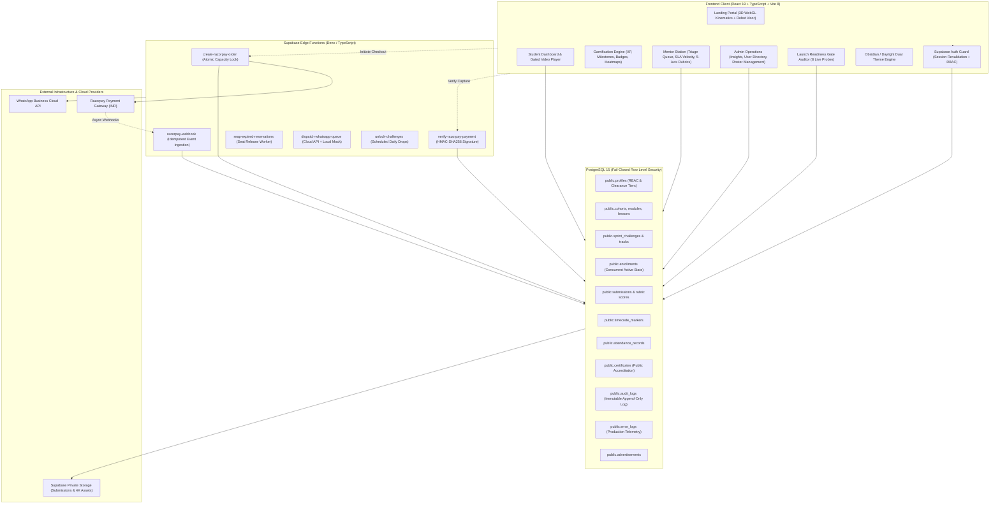
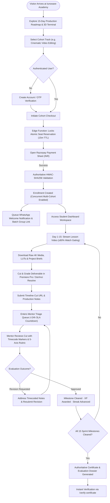
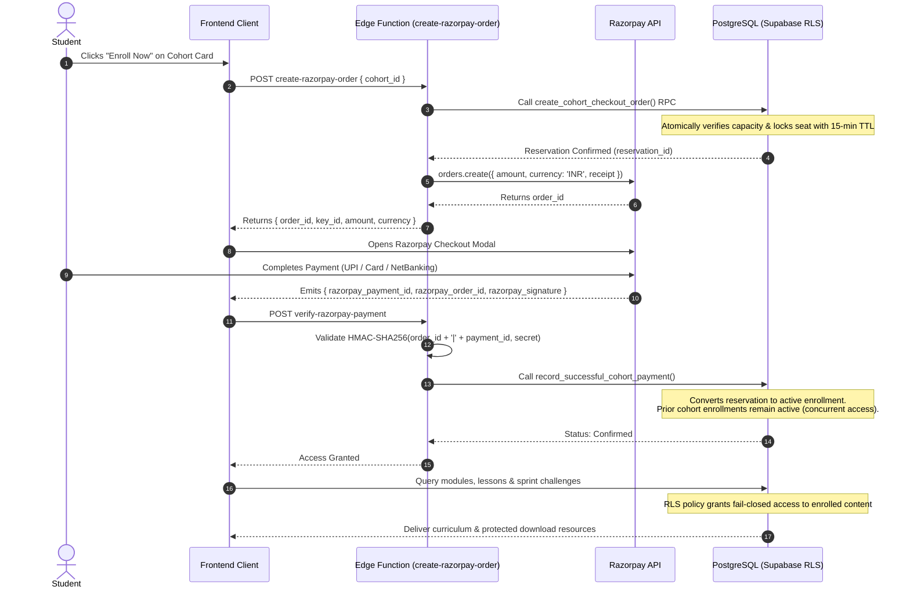
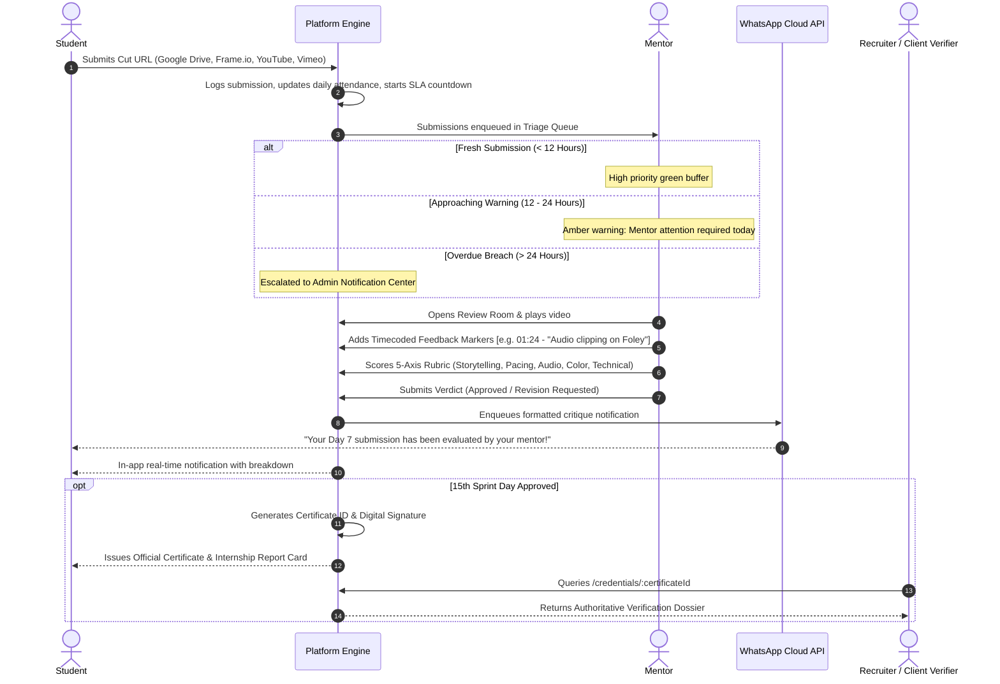
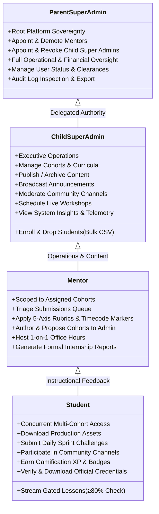

<div align="center">
  <a href="https://video-editing-cohort-platform.vercel.app" target="_blank">
    
  </a>
  
  <h1>Iunoware Academy</h1>
  <p><strong>Video Editing &amp; Creative Production Cohort Platform</strong></p>
  <p>A high-throughput, fail-closed platform engineered for professional video editing cohorts, intensive daily production sprints, real-time mentor critique with sub-24h SLAs, and accredited internship credentialing.</p>

  <p>
    <a href="https://video-editing-cohort-platform.vercel.app" target="_blank"><strong>🌐 Live Production Application »</strong></a>
  </p>

  <p>
    <a href="https://vitejs.dev/"></a>
    <a href="https://react.dev/"></a>
    <a href="https://www.typescriptlang.org/"></a>
    <a href="https://tailwindcss.com/"></a>
    <a href="https://threejs.org/"></a>
    <a href="https://supabase.com/"></a>
    <a href="https://razorpay.com/"></a>
    <a href="https://vitest.dev/"></a>
    <a href="#database-architecture--security-rls"></a>
    <a href="#license"></a>
  </p>
</div>

---

## Executive Summary

**Iunoware Academy** is an enterprise-grade educational, production sprint, and mentorship platform purpose-built for commercial video editors, motion graphic designers, and post-production artists. Moving beyond passive video consumption, the platform powers an intensive, accountability-driven educational model structured around:

1. **15-Day Production Sprints**: Daily milestone deliverables, raw 4K source assets, LUT packs, sound effects libraries, and timeline challenges.
2. **Strict <24-Hour Review SLAs**: Dedicated mentor triage station with live aging indicators (*Fresh <12h*, *Approaching Warning 12–24h*, *Overdue Breaches >24h*).
3. **5-Axis Standardized Rubric Matrix**: Objective 1-to-5 point evaluations across *Storytelling & Arc*, *Pacing & Rhythm*, *Audio & Sound Design*, *Color Grade & Match*, and *Technical Polish*.
4. **Timecode Frame-Accurate Critique Markers**: Click-to-capture playhead timecodes with direct timeline seek synchronization.
5. **Multi-Cohort Concurrent Access**: Students can enroll in and progress through multiple cohort tracks (e.g., Commercial Video Editing, 3D Motion Graphics, DaVinci Color Grading) simultaneously with atomic checkout and seat reservation locking.
6. **4-Tier Granular RBAC Sovereignty**: Clear operational hierarchy separating *Parent Super Admin*, *Child Super Admin*, *Cohort Mentor*, and *Student*.
7. **Production Observability & 8-Point Launch Readiness Gate**: Real-time telemetry, sliding-window anomaly detectors, audit logs, and an in-app verification gate auditing security and database policies against live infrastructure.
8. **Public Cryptographic Credentialing**: Tamper-proof, digitally signed certificates with verifiable internship evaluation dossiers.

---

## Table of Contents

- [Executive Summary](#executive-summary)
- [Architectural Blueprint](#architectural-blueprint)
- [System Workflows & Sequence Diagrams](#system-workflows--sequence-diagrams)
  - [1. End-to-End Student Production Journey](#1-end-to-end-student-production-journey)
  - [2. Atomic Seat Reservation & Razorpay Checkout](#2-atomic-seat-reservation--razorpay-checkout)
  - [3. Mentor Triage, Timecode Critique & SLA Pipeline](#3-mentor-triage-timecode-critique--sla-pipeline)
  - [4. 4-Tier RBAC Sovereignty & Permission Matrix](#4-4-tier-rbac-sovereignty--permission-matrix)
- [Core Platform Modules](#core-platform-modules)
  - [🎨 3D WebGL Canvas & Retro-Futuristic Terminal](#-3d-webgl-canvas--retro-futuristic-terminal)
  - [🎬 Student Learning Studio & Custom Video Player](#-student-learning-studio--custom-video-player)
  - [🏆 Gamification Engine & Habit Tracker](#-gamification-engine--habit-tracker)
  - [🧑‍🏫 Mentor Command Center & Review Station](#-mentor-command-center--review-station)
  - [🛡️ Admin Operations Center & Control Room](#️-admin-operations-center--control-room)
  - [🚀 Launch Readiness Gate (8 Mandatory Criteria)](#-launch-readiness-gate-8-mandatory-criteria)
  - [💬 Community Hub, Channels & Live Masterclasses](#-community-hub-channels--live-masterclasses)
  - [📜 Public Credential Verification & Internship Dossier](#-public-credential-verification--internship-dossier)
  - [🌙 Responsive Design System & Obsidian Dark Theme](#-responsive-design-system--obsidian-dark-theme)
- [Technology Stack](#technology-stack)
- [Database Architecture & Security (RLS)](#database-architecture--security-rls)
- [Project Directory Structure](#project-directory-structure)
- [Developer Quickstart](#developer-quickstart)
  - [Prerequisites](#prerequisites)
  - [Environment Configuration](#environment-configuration)
  - [Installation & Development](#installation--development)
  - [Database Bootstrapping & Migrations](#database-bootstrapping--migrations)
- [Testing & Quality Assurance](#testing--quality-assurance)
- [Production Deployment](#production-deployment)
- [License](#license)

---

## Architectural Blueprint

The platform adheres to a zero-trust, fail-closed client-server model. The frontend client communicates directly with PostgreSQL via Supabase's authenticated client for standard operational queries guarded by Row Level Security (RLS), and invokes Supabase Edge Functions for atomic business logic, payment capture, and external gateway dispatch.



---

## System Workflows & Sequence Diagrams

### 1. End-to-End Student Production Journey



---

### 2. Atomic Seat Reservation & Razorpay Checkout

To avoid overselling cohort capacity and race conditions during high-demand cohort launches, the platform employs **atomic seat reservation locking** with server-authoritative payment capture.



---

### 3. Mentor Triage, Timecode Critique & SLA Pipeline



---

### 4. 4-Tier RBAC Sovereignty & Permission Matrix

The platform strictly implements a **4-tier granular permission hierarchy** defined in [`adminPermissions.ts`](file:///Users/ramananm/Documents/Iunoware/Project/video-editing-cohort-platform/src/lib/adminPermissions.ts):



| Permission Key | Parent Super Admin | Child Super Admin | Mentor | Student |
|---|:---:|:---:|:---:|:---:|
| `manage_roles` (Promote/Demote Admins) | ✅ | ❌ | ❌ | ❌ |
| `manage_user_status` (Suspend/Reactivate) | ✅ | ✅ | ❌ | ❌ |
| `manage_cohorts` & `manage_curriculum` | ✅ | ✅ | Proposals | ❌ |
| `publish_content` (Live Course Catalog) | ✅ | ✅ | ❌ | ❌ |
| `manage_enrollments` (Roster & Bulk CSV) | ✅ | ✅ | ❌ | ❌ |
| `view_audit_logs` (Security Trail) | ✅ | ✅ | ❌ | ❌ |
| `view_insights` (Executive Analytics) | ✅ | ✅ | Scoped | ❌ |
| `evaluate_submissions` (Rubric & Markers) | ✅ | ✅ | Assigned | ❌ |
| `schedule_sessions` (Live Workshops) | ✅ | ✅ | Own Slots | ❌ |
| `submit_challenges` & `stream_lessons` | ❌ | ❌ | ❌ | ✅ |

---

## Core Platform Modules

### 🎨 3D WebGL Canvas & Retro-Futuristic Terminal
* **Interactive 3D Kinematics Visualizer**: Mathematical GPU canvas rendering three dynamic modes:
  * **Wave**: Undulating topological vertex matrix with connected splines and mouse elevation physics.
  * **Nebula**: 1,400 gravitational particle nodes with neural filaments and orbital velocity.
  * **Grid**: Retro-futuristic Tron perspective wireframe mesh with real-time mouse-induced surface warping.
* **Three.js Retro Robot Terminal (`RobotTerminal.tsx`)**: High-fidelity GLTF 3D model featuring animated cooling fan blades, CRT visor scanlines, procedural audio sweeps, and dynamic lighting.
* **Freelance Income Simulator**: Interactive ROI projection tool calculating client project value, monthly timeline turnaround, and estimated annual creative earnings.
* **Procedural Sound FX Synthesizer**: Custom Web Audio API procedural sound synthesizer for clicks, hover sweeps, modal transitions, and milestone completion chimes.

### 🎬 Student Learning Studio & Custom Video Player
* **High-Performance Player Suite (`VideoScreen.tsx`, `LessonPlayer.tsx`)**:
  * **Watch Verification Engine**: Enforces minimum 80% watch time requirement before allowing challenge milestone submission.
  * **Automated Signed URL Refreshing**: Failover mechanism that transparently re-authenticates expired Cloud Storage signed URL tokens without interrupting student viewing.
  * **Playback Resume Position**: Persists playback timestamps to Supabase; prompts students to resume right where they left off.
  * **Comprehensive Keyboard Shortcuts**: Spacebar to toggle play/pause, `F` for fullscreen, and `←` / `→` arrows for precision ±5-second scrubbing.
  * **Playback Speed Controls**: Native rate adjustment from 0.75x to 2.0x.
* **Gated Sprint Track Studio**: Daily milestone progression prevents skipping ahead until current cuts are formally approved.
* **Multi-Course Live Switcher**: Header bar enabling instantaneous switching between multiple concurrently enrolled cohort tracks.

### 🏆 Gamification Engine & Habit Tracker
* **Gamification Architecture (`gamificationService.ts`)**:
  * **XP & Tier Ranking**: 5 editor tiers ranging from *Novice Apprentice* to *Master Lead Editor*.
  * **Milestone Badges**: 7 achievement badges categorized across *Craft*, *Consistency*, *Timeline*, and *Creativity* with interactive badge modals (`AchievementsModal.tsx`).
  * **Habit Heatmap Matrix (`HabitHeatmapCard.tsx`)**: GitHub-style activity heatmaps displaying continuous learning streaks.
  * **Studio Copilot Card (`StudioCopilotCard.tsx`)**: AI-guided contextual suggestions recommending the next highest-priority action for the student.

### 🧑‍🏫 Mentor Command Center & Review Station
* **SLA Queue Velocity & Aging Metrics**:
  * Three triage buckets: **Fresh (<12h)**, **Approaching Warning (12–24h)**, and **Overdue Breaches (>24h)**.
* **5-Axis Cohort Student Skill Distribution**:
  * Real-time aggregate analytics across *Storytelling & Arc*, *Pacing & Rhythm*, *Audio & Sound Design*, *Color Grade & Match*, and *Technical Polish*.
  * Responsive multi-breakpoint grid layout (`grid-cols-1 sm:grid-cols-2 md:grid-cols-3 xl:grid-cols-5`) with truncation safety across tablet and mobile viewports.
* **Urgent Student Performance Alerts**:
  * Proactive identification of stalled learners, inactivity streaks, and multiple revision bottlenecks.
* **Interactive Timecode Critique Marker Builder (`ReviewSubmissions.tsx`)**:
  * Click-to-capture frame timecodes, assign category badges, and type actionable feedback. Clicking markers immediately jumps the video player to that timestamp.
* **1-on-1 Office Hours Scheduler**:
  * Mentor calendar slot booking integrated with Google Meet / Zoom links.

### 🛡️ Admin Operations Center & Control Room
* **Executive Insights (`InsightsTab.tsx`)**: Cohort conversion metrics, revenue projections, student attrition detection, and mentor turnaround leaderboards.
* **User Management & Clearance (`UsersTab.tsx`)**: Granular role assignments, status management (Active, Inactive, Suspended), and full staff rosters.
* **Course & Curriculum Authoring (`AdminCourses/`)**: Cohort creation, syllabus builder, lesson asset attachment, and daily challenge configuration.
* **Bulk Sprint Import (`BulkImportSprintModal.tsx`)**: Rapid batch syllabus importing via CSV upload or formatted JSON text paste with validation schema checks.
* **Audit Trail (`AuditLogsTab.tsx`)**: Tamper-proof, immutable ledger of all administrative actions with JSON metadata inspection and CSV export.
* **Promotional Banner Center (`AdvertisementsTab.tsx`)**: Direct management of homepage marketing banners and popups with Supabase Storage asset hosting.

---

### 🚀 Launch Readiness Gate (8 Mandatory Criteria)

Built into [`launchReadinessGate.ts`](file:///Users/ramananm/Documents/Iunoware/Project/video-editing-cohort-platform/src/lib/observability/launchReadinessGate.ts) and surfaced directly in the Admin Control Room (`SystemHealthTab.tsx`), the **Launch Readiness Gate** programmatically audits live database policies, storage settings, and edge configurations against 8 mandatory enterprise criteria:

```
┌─────────────────────────────────────────────────────────────────────────────┐
│                       LAUNCH READINESS GATE AUDITOR                         │
├────┬─────────────────────────────┬──────────────┬───────────────────────────┤
│ #  │ Criterion                   │ Category     │ Live Enforcement Mechanism│
├────┼─────────────────────────────┼──────────────┼───────────────────────────┤
│ 1  │ Database-Enforced RLS Rules │ Security     │ Zero client role trust;   │
│    │                             │              │ is_admin() DB validation  │
├────┼─────────────────────────────┼──────────────┼───────────────────────────┤
│ 2  │ Private Storage & Uploads   │ Privacy      │ public=false on buckets;  │
│    │                             │              │ 1-hour TTL signed URLs    │
├────┼─────────────────────────────┼──────────────┼───────────────────────────┤
│ 3  │ Role-Based Route Protection │ Routing      │ ProtectedRoute locks with │
│    │                             │              │ on-navigation DB checks   │
├────┼─────────────────────────────┼──────────────┼───────────────────────────┤
│ 4  │ Data Isolation & No Leaks   │ Data         │ Public landing queries    │
│    │                             │              │ decoupled from payments   │
├────┼─────────────────────────────┼──────────────┼───────────────────────────┤
│ 5  │ Comprehensive Error Safety  │ Resilience   │ parseDatabaseError maps   │
│    │                             │              │ all Postgres error codes  │
├────┼─────────────────────────────┼──────────────┼───────────────────────────┤
│ 6  │ Paid-Only & Checkout Safety │ QA / FinSec  │ Zero free-cohort bypass;  │
│    │                             │              │ atomic seat reservations  │
├────┼─────────────────────────────┼──────────────┼───────────────────────────┤
│ 7  │ Real-Time Telemetry & Alerts│ Observability│ ErrorTracker & sliding    │
│    │                             │              │ window anomaly detector   │
├────┼─────────────────────────────┼──────────────┼───────────────────────────┤
│ 8  │ RBAC Matrix & Mentor Scoping│ Access Ctrl  │ Parent/Child Admin roles; │
│    │                             │              │ mentor cohort boundaries  │
└────┴─────────────────────────────┴──────────────┴───────────────────────────┘
```

---

### 💬 Community Hub, Channels & Live Masterclasses
* **Live Community Board (`CommunityBoard.tsx`)**: Real-time topic channels backed by PostgreSQL Realtime subscriptions with Markdown support, code formatting, and asset previews.
* **Peer Critique & Reactions**: Emoji reactions and threaded discussions on sprint cuts.
* **Live Workshops (`WorkshopsPage.tsx`)**: Upcoming and completed masterclass directory with RSVP tracking, calendar exports, and recorded replay archives.

### 📜 Public Credential Verification & Internship Dossier
* **Zero-Trust Public Accreditation (`/verify-certificate`, `/credentials/:certificateId`)**:
  * Verifiable credential verification matching digitally signed records in PostgreSQL.
  * Displays certified graduate name, verified skills, completion date, and issuing authority.
* **Authoritative Internship Dossier**: Detailed report card summarizing completion metrics, attendance consistency, and 5-axis rubric performance.

### 🌙 Responsive Design System & Obsidian Dark Theme
* **Adaptive Dual Theme**: Bespoke deep Obsidian dark palette (`#030712`, `#0e1424`, `#090d1a`, `surface-card`, `surface-elevated`) engineered for video editors working in low-light editing suites.
* **100% Viewport Tested**: Full layout responsiveness audited and tested across:
  * Mobile Portrait (320px – 480px)
  * Mobile Landscape (480px – 767px)
  * Tablet Portrait & Landscape (768px – 1024px, including iPad Pro 13")
  * Desktop & Ultra-wide displays (1024px – 2560px+)

---

## Technology Stack

```
Frontend Architecture
  ├── Core Framework: React 19.2 (Functional Components & Hooks)
  ├── Build Toolchain: Vite 8.3 & Rolldown Bundler
  ├── Language: TypeScript 6.0 (Strict Type Checking)
  ├── Styling Engine: Tailwind CSS 4.3 (CSS Custom Properties & JIT)
  ├── 3D Graphics: Three.js 0.186 (DRACO Mesh Compression & Custom Shaders)
  ├── Motion & Physics: GSAP 3.15 & Lenis 1.3 Smooth Scrolling
  ├── Icons: Lucide React
  ├── Routing: React Router DOM 7.18
  └── Schema Validation: Zod 4.6

Backend & Persistence
  ├── Database: Supabase Managed PostgreSQL 15
  ├── Access Control: Row Level Security (RLS) with Fail-Closed Policies
  ├── Realtime Engine: PostgreSQL WAL Logical Replication via Supabase Realtime
  ├── Object Storage: Supabase Storage (Private Buckets with 1-Hour Signed Tokens)
  └── Serverless Logic: Supabase Edge Functions (Deno / TypeScript runtime)

External Gateways & Integrations
  ├── Payments: Razorpay Checkout SDK & Authoritative Webhook Reconciliation (INR)
  ├── Communications: WhatsApp Business Cloud API (Templates, Delivery Logging & Webhooks)
  └── Telemetry & Alerts: In-App ErrorTracker, AlertManager & Database Error Logs

Testing & Code Quality
  ├── Test Runner: Vitest 5.0 (101 Suites · 880 Tests Passing)
  ├── DOM Testing: React Testing Library 16.3 & JSDOM 30.1
  └── Linter: ESLint 10.10 (Zero Errors Enforcement)
```

---

## Database Architecture & Security (RLS)

All sensitive application tables enforce **fail-closed** PostgreSQL Row Level Security (RLS). Zero client-side role assertions are trusted:

```sql
-- Architectural Security Principle: Security functions execute with SECURITY DEFINER
CREATE OR REPLACE FUNCTION public.is_admin()
RETURNS BOOLEAN AS $$
BEGIN
  RETURN EXISTS (
    SELECT 1 FROM public.profiles
    WHERE id = auth.uid() AND role = 'admin' AND status = 'active'
  );
END;
$$ LANGUAGE plpgsql SECURITY DEFINER;
```

### Table Security Manifest

| Table Name | Read Access Policy | Mutation Access Policy |
|---|---|---|
| `public.profiles` | Public read for display cards | Update restricted to row owner or Super Admin |
| `public.cohorts` | Public read for `status = 'published'` | Creation/editing restricted to Admins |
| `public.enrollments` | Enrolled student or Admin | Managed atomically by payment Edge Functions |
| `public.modules` & `lessons` | **Strictly enrolled cohort members** or Admins | Admin / authorized Course Authors only |
| `public.sprint_challenges` | **Strictly enrolled cohort members** or Admins | Admin / Mentor authors |
| `public.submissions` | Submission owner, assigned Mentor, Admin | Created by student; updated by assigned Mentor |
| `public.reviews` | Submission owner, assigned Mentor, Admin | Insert/Update strictly assigned Mentor or Admin |
| `public.payments` | **Row owner only** or Super Admin | Inserted strictly via verified Razorpay Edge Function |
| `public.certificates` | **Public read** for valid credential verification | Generated exclusively by system triggers |
| `public.audit_logs` | Platform Administrators only | Append-only system trigger; immutable |
| `public.error_logs` | Platform Administrators only | App-level diagnostic logging |

---

## Project Directory Structure

```
video-editing-cohort-platform/
├── .env.example                               # Environment template
├── index.html                                 # HTML entry point with preload assets
├── package.json                               # Dependencies & lifecycle scripts
├── tsconfig.json                              # TypeScript strict configuration
├── vite.config.ts                             # Vite build & optimization config
├── scripts/
│   ├── bootstrap-database.ts                  # Remote database initialization script
│   ├── verify-and-bundle-migrations.ts        # Migration bundle & manifest validator
│   └── verify-edge-function-secrets.ts        # Serverless secret auditor
├── supabase/
│   ├── bootstrap_complete_schema.sql          # 870+ KB Consolidated database schema
│   ├── migrations_manifest.json               # Ordered migration ledger
│   ├── functions/
│   │   ├── create-razorpay-order/             # Atomic checkout & capacity reservation
│   │   ├── verify-razorpay-payment/           # HMAC-SHA256 signature verification
│   │   ├── razorpay-webhook/                  # Idempotent async payment fulfillment
│   │   ├── reap-expired-reservations/         # Scheduled worker releasing lapsed seats
│   │   ├── dispatch-whatsapp-queue/           # WhatsApp Cloud delivery dispatcher
│   │   └── unlock-challenges/                 # Automated daily sprint release engine
│   └── migrations/                            # 75+ Sequential SQL migration scripts
└── src/
    ├── App.tsx                                # Root route definitions & shell
    ├── main.tsx                               # Application bootstrap
    ├── index.css                              # Tailwind CSS design tokens & utilities
    ├── components/
    │   ├── AdminNotificationCenter.tsx        # Real-time admin SLA & risk popover
    │   ├── CertificateModal.tsx               # PDF rendering & credential download
    │   ├── CommunityBoard.tsx                 # Realtime channel chat component
    │   ├── ErrorBoundary.tsx                  # Top-level fault isolation boundary
    │   ├── NotificationCenter.tsx             # Student in-app notifications
    │   ├── ProtectedRoute.tsx                 # Zero-trust route & clearance guard
    │   ├── StudentFlowPanels.tsx              # Discovery modals & milestone banners
    │   ├── TopRightControls.tsx               # Header profile, theme & notifications
    │   ├── UserProfileDropdown.tsx            # Contextual user navigation menu
    │   ├── WorkspaceSidebar.tsx               # Responsive collateral navigation
    │   ├── admin/tabs/                        # Control Room tab components
    │   │   ├── AdvertisementsTab.tsx          # Banner campaign manager
    │   │   ├── AuditLogsTab.tsx               # Immutable security trail
    │   │   ├── EnrollmentsTab.tsx             # Bulk CSV rosters & student access
    │   │   ├── InsightsTab.tsx                # Executive telemetry & dropout risks
    │   │   ├── SystemHealthTab.tsx            # 8-Point Launch Readiness Gate UI
    │   │   └── UsersTab.tsx                   # Granular RBAC clearance management
    │   ├── home/                              # Landing page sections & 3D canvas
    │   │   ├── Canvas3D.tsx                   # Three.js 3D mathematical visualizer
    │   │   ├── RobotTerminal.tsx              # Three.js GLTF animated terminal
    │   │   └── sections/                      # Testimonials, pricing & FAQ
    │   └── student/
    │       ├── AchievementsModal.tsx          # Editor levels & badge inspector
    │       ├── StudentPlayerView.tsx          # Active course player orchestrator
    │       └── player/                        # VideoScreen, Sidebar, ResourceList
    ├── context/
    │   ├── AuthContext.tsx                    # Authentication state provider
    │   └── ToastContext.tsx                   # Floating feedback notifications
    ├── lib/
    │   ├── adminPermissions.ts                # 4-Tier RBAC permission matrix
    │   ├── adminService.ts                    # Admin mutation APIs
    │   ├── errorHandling.ts                   # Unified PostgreSQL error mapper
    │   ├── gamificationService.ts             # XP points & badge evaluation
    │   ├── mentorService.ts                   # Submissions, rubrics & SLA analytics
    │   ├── paymentService.ts                  # Razorpay SDK integration
    │   ├── supabaseClient.ts                  # Initialized Supabase singleton
    │   ├── whatsappService.ts                 # WhatsApp template dispatcher
    │   └── observability/                     # Telemetry, alerts & readiness gate
    │       ├── alerts.ts                      # Anomaly & spike alert manager
    │       ├── errorTracking.ts               # In-memory breadcrumb buffer
    │       ├── healthCheck.ts                 # Supabase ping probes
    │       └── launchReadinessGate.ts         # 8-Criterion readiness auditor
    ├── pages/
    │   ├── AdminCourses/                      # Curriculum & challenge authoring
    │   ├── AdminOperations.tsx                # Admin Control Room
    │   ├── CommunityHub.tsx                   # Collaborative channels
    │   ├── ForgotPassword.tsx & ResetPassword # OTP password recovery
    │   ├── Home.tsx                           # Landing page
    │   ├── Login.tsx & Register.tsx           # Authentication workflows
    │   ├── MentorDashboard.tsx                # SLA queue velocity & triage station
    │   ├── MentorStudents.tsx                 # Student intelligence dossiers
    │   ├── ParentSuperAdminRegister.tsx       # Root sovereignty onboarding
    │   ├── ReviewSubmissions.tsx              # Frame critique & 5-axis rubrics
    │   ├── StudentDashboard.tsx               # Player & sprint workspace
    │   ├── UserProfile.tsx                    # Multi-cohort payment ledger & settings
    │   ├── VerifyCertificate.tsx              # Public zero-trust credential check
    │   └── WorkshopsPage.tsx                  # Masterclass directory & RSVP
    └── __tests__/                             # 101 Test Suites (880 tests)
```

---

## Developer Quickstart

### Prerequisites
* **Node.js**: `v20.x` or higher (LTS recommended)
* **npm**: `v10.x` or higher
* **Supabase Project**: An active project with PostgreSQL, Auth, and Storage enabled
* **Razorpay Account**: (Optional for test mode) Razorpay Key ID and Key Secret

### Environment Configuration

Create a `.env` file in the root workspace directory:

```bash
cp .env.example .env
```

Populate the required configuration variables:

```ini
# Supabase Public API (Required)
VITE_SUPABASE_URL=https://your-project.supabase.co
VITE_SUPABASE_ANON_KEY=your-supabase-public-anon-key

# Razorpay Client Configuration (Required for payments)
# Development: rzp_test_... | Production: rzp_live_...
VITE_RAZORPAY_KEY_ID=rzp_test_your_key_id

# Optional: Allow test payments in production environment (defaults to false)
VITE_ALLOW_TEST_PAYMENTS_IN_PROD=false

# Optional: WhatsApp Provider Mode (mock | cloud)
VITE_WHATSAPP_PROVIDER=mock

# Optional: Error Observability
VITE_SENTRY_DSN=
```

### Installation & Development

```bash
# 1. Install all dependencies
npm install

# 2. Launch Vite local development server
npm run dev
```

Open `http://localhost:5173` in your browser.

### Database Bootstrapping & Migrations

The repository provides automated migration verification and schema bootstrapping utilities:

```bash
# 1. Verify schema manifest integrity against sequential migrations
npm run migrations:verify

# 2. Bundle all incremental migrations into the master bootstrap SQL
npm run migrations:bundle

# 3. Direct schema initialization (requires SUPABASE_DB_URL in environment)
npm run db:bootstrap
```

Alternatively, copy the complete contents of [`supabase/bootstrap_complete_schema.sql`](./supabase/bootstrap_complete_schema.sql) into the **Supabase Dashboard > SQL Editor** and execute it.

---

## Testing & Quality Assurance

The codebase enforces strict quality gates through comprehensive automated testing with **101 test suites and 880 tests**:

```bash
# Execute full Vitest test suite
npm test

# Run Vitest in interactive watch mode
npm run test:watch

# Execute Row Level Security (RLS) database integration tests
npm run test:rls

# Run ESLint validation (0 warnings / 0 errors policy)
npm run lint

# Run TypeScript compilation check
npx tsc -b

# Comprehensive full production readiness verification (lint + build + test)
npm run verify
```

---

## Production Deployment

### Frontend (Vercel / Cloudflare Pages / AWS Amplify)

1. Connect the Git repository to your deployment provider.
2. Configure Build & Output settings:
   - **Framework Preset**: Vite
   - **Build Command**: `npm run build`
   - **Output Directory**: `dist`
3. Add Environment Variables:
   - `VITE_SUPABASE_URL`
   - `VITE_SUPABASE_ANON_KEY`
   - `VITE_RAZORPAY_KEY_ID`

### Supabase Edge Functions Deployment

Deploy serverless edge functions for payment webhooks, notifications, and seat release workers:

```bash
# Login to Supabase CLI
supabase login

# Deploy all Edge Functions
supabase functions deploy create-razorpay-order
supabase functions deploy verify-razorpay-payment
supabase functions deploy razorpay-webhook
supabase functions deploy reap-expired-reservations
supabase functions deploy dispatch-whatsapp-queue
supabase functions deploy unlock-challenges

# Configure secure server-side secrets
supabase secrets set RAZORPAY_KEY_ID=rzp_live_...
supabase secrets set RAZORPAY_KEY_SECRET=your_razorpay_secret
supabase secrets set RAZORPAY_WEBHOOK_SECRET=your_webhook_secret
```

---

## License

This platform is proprietary software developed for **Iunoware Academy**. All rights reserved. Unauthorized copying, distribution, or commercial exploitation is strictly prohibited.
