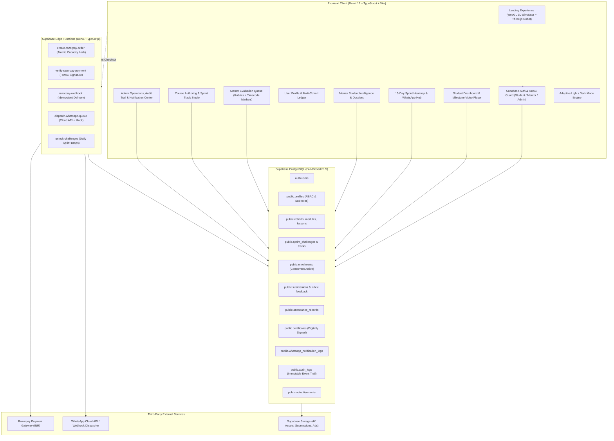
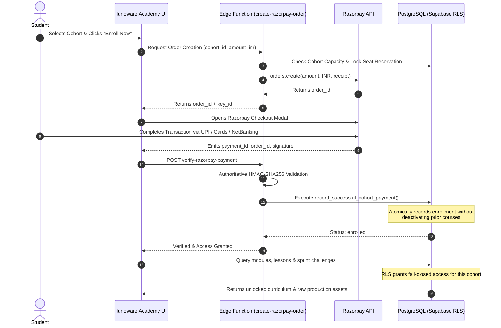
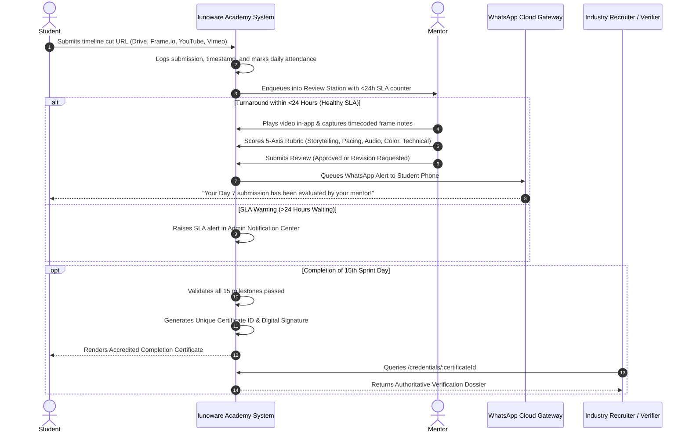

# Iunoware Academy · Video Editing & Creative Production Cohort Platform

<div align="center">
  
  <p><strong>Enterprise-Grade Cohort Learning, Production Sprints & Creative Mentorship Platform</strong></p>
</div>

[](https://vitejs.dev/)
[](https://react.dev/)
[](https://www.typescriptlang.org/)
[](https://tailwindcss.com/)
[](https://threejs.org/)
[](https://supabase.com/)
[-02042B?logo=razorpay&logoColor=3395FF)](https://razorpay.com/)
[](https://vitest.dev/)

**Iunoware Academy** is an enterprise-grade, full-stack educational and production sprint platform engineered for cohort-based creative training and internship execution. Built for aspiring video editors, motion designers, and creative directors, it unifies intensive daily production challenges, real-time mentor evaluation with strict turnaround SLAs, 5-axis standardized rubric grading, automated WhatsApp delivery & batch community integration, interactive 3D WebGL visuals, multi-cohort concurrent access, and tamper-proof public accreditation.

---

## Table of Contents

- [Architectural Overview](#architectural-overview)
- [System Flowcharts](#system-flowcharts)
  - [1. Learner Journey & Production Lifecycle](#1-learner-journey-production-lifecycle)
  - [2. Multi-Cohort Concurrent Enrollment & Payment](#2-multi-cohort-concurrent-enrollment-payment)
  - [3. Submission Evaluation, Timecode Critique & Certification](#3-submission-evaluation-timecode-critique-certification)
- [Core Features & Modules](#core-features-modules)
  - [Landing Experience & 3D WebGL Simulator](#landing-experience-3d-webgl-simulator)
  - [Student Learning Portal & Custom Video Player](#student-learning-portal-custom-video-player)
  - [15-Day Internship & WhatsApp Hub](#15-day-internship-whatsapp-hub)
  - [Student Profile & Payment Ledger](#student-profile-payment-ledger)
  - [Mentor Operations & Student Intelligence](#mentor-operations-student-intelligence)
  - [Evaluation Suite & 5-Axis Rubric Matrix](#evaluation-suite-5-axis-rubric-matrix)
  - [Admin Course Studio & Sprint Track Authoring](#admin-course-studio-sprint-track-authoring)
  - [Admin Operations, Observability & Notification Center](#admin-operations-observability-notification-center)
  - [Community Hub & Real-Time Engagement](#community-hub-real-time-engagement)
  - [Public Credential Verification](#public-credential-verification)
  - [Comprehensive Dark Mode Consistency](#comprehensive-dark-mode-consistency)
- [Tech Stack](#tech-stack)
- [Database Schema & Security (RLS)](#database-schema-security-rls)
- [Getting Started](#getting-started)
  - [Prerequisites](#prerequisites)
  - [Environment Setup](#environment-setup)
  - [Installation & Local Run](#installation-local-run)
  - [Database Bootstrap & Migrations](#database-bootstrap-migrations)
- [Testing & Quality Assurance](#testing-quality-assurance)
- [Deployment](#deployment)
- [License](#license)

---

## Architectural Overview

Iunoware Academy is architected around a zero-trust, fail-closed design with complete separation of concerns between presentation, server-state management, authoritative edge logic, and Row Level Security (RLS) database policies.



---

## System Flowcharts

### 1. Learner Journey & Production Lifecycle

```mermaid
flowchart TD
    Start([Visitor Discovers Iunoware Academy]) --> Explore[Explore 15-Day Sprint Roadmap & 3D Simulator]
    Explore --> PromoCheck{Active Announcement / Promo Banner?}
    PromoCheck -- Yes --> ViewPromo[Review Limited-Time Offer]
    PromoCheck -- No --> BrowseCohorts[Browse Available Creative Cohorts]
    ViewPromo --> BrowseCohorts

    BrowseCohorts --> AuthCheck{Registered & Authenticated?}
    AuthCheck -- No --> SignUp[Register / Sign In via Supabase Auth]
    SignUp --> Checkout[Initiate Cohort Checkout]
    AuthCheck -- Yes --> Checkout

    Checkout --> Razorpay[Razorpay Payment Sheet (INR)]
    Razorpay -- Captured --> SignatureCheck[HMAC-SHA256 Signature Verification]
    SignatureCheck --> RecordEnrollment[Concurrent Cohort Enrollment Created]

    RecordEnrollment --> WelcomeWA[WhatsApp Welcome Notification & Batch Group Link]
    WelcomeWA --> Dashboard[Access Student Workspace]

    Dashboard --> DailySprint[Day 1-15: Stream Lesson & Download Production Assets]
    DailySprint --> EditCut[Cut, Grade & Mix Deliverable in Premiere / Resolve]
    EditCut --> UploadSubmission[Submit Project Cut URL]

    UploadSubmission --> Queue[Enters Mentor Review Queue <24h SLA]
    Queue --> Evaluation[Mentor Grades 5-Axis Rubric & Leaves Timecoded Notes]
    Evaluation --> NotifyStudent[Instant WhatsApp & In-App Alert Dispatched]

    NotifyStudent --> RevisionCheck{Revision Requested?}
    RevisionCheck -- Yes --> Resubmit[Inspect Prior Critiques & Resubmit Revision]
    Resubmit --> Queue
    RevisionCheck -- No --> NextMilestone[Advance Sprint Streak & Next Day Milestone]

    NextMilestone --> Check15{All 15 Sprint Days Approved?}
    Check15 -- No --> DailySprint
    Check15 -- Yes --> GenerateCert[Authoritative Certificate Generation]
    GenerateCert --> FormalReport[Internship Performance Report & Verifiable Credential]
```

---

### 2. Multi-Cohort Concurrent Enrollment & Payment

Students can purchase and actively participate in **multiple cohorts simultaneously** (e.g. *Cinematic Video Editing*, *Motion Graphics*, *Color Grading*) without one enrollment canceling or overwriting another.



---

### 3. Submission Evaluation, Timecode Critique & Certification



---

## Core Features & Modules

### 🎨 Landing Experience & 3D WebGL Simulator
* **Interactive 3D WebGL Canvas**: Mathematical kinematics visualizer with three live modes:
  * **Wave**: Undulating 3D matrix with connecting splines and dynamic mouse elevation.
  * **Nebula**: 1,400 cosmic star nodes orbiting in gravitational harmony with neural filaments.
  * **Grid**: Retro-futuristic Tron perspective wireframe mesh with real-time mouse warp.
* **Retro-Futuristic 3D Robot Terminal**: High-fidelity Three.js GLTF character with CRT visor scanlines, cooling fan animation, and audio sweep feedback.
* **Freelance Earnings Calculator**: Real-time interactive ROI simulator projecting client income for video editors transitioning into commercial production.
* **Audio & Motion System**: Custom procedural Web Audio API sound FX synthesizer paired with Lenis smooth scrolling and GSAP scroll triggers.

### 📚 Student Learning Portal & Custom Video Player
* **Modular Video Player Architecture**: Composed of clean components (`VideoScreen`, `LessonSidebar`, `ResourceList`, `AssignmentSubmitCard`).
* **Milestone Progression Gating**: Fail-closed logic prevents skipping ahead until current project brief is reviewed and accepted.
* **Production Resource Downloads**: Secure access to raw 4K project files, sound libraries, LUTs, and brief documents.
* **Attendance Automation**: Automatic attendance tracking synchronized with daily lesson watch time and assignment submissions.

### ⚡ 15-Day Internship & WhatsApp Hub
* **Production Sprint Heatmap**: Daily milestone completion tracker displaying streak health, days remaining, and project deliverable status.
* **WhatsApp Community Group**: One-click join to the official batch discussion group ([Join WhatsApp Batch Group](https://chat.whatsapp.com/G7tEsqF5Mq1FzLzZHlpHjz?mode=gi_t)).
* **WhatsApp Mentor Support Widget**:
  * Direct 1-on-1 click-to-chat with assigned cohort mentors (`normalizeWhatsAppPhone` with automatic Indian `91` country code handling).
  * **Desktop QR Code Modal**: Scan-to-chat QR code powered by Google Charts API for instant mobile chatting without needing WhatsApp Web logged in.
  * **Popup-Blocker Resilience**: Synchronous window opening on user gesture with asynchronous background telemetry logging.
* **Automated WhatsApp Notifications**: Cloud delivery logs, delivery status tracking (queued, sent, delivered, read), and retry capabilities (`WhatsAppMonitoringModal`).

### 👤 Student Profile & Payment Ledger
* **Comprehensive Profile Dashboard**: Displays student identity, contact info, sprint attendance rates, and enrolled cohort rosters.
* **Authoritative Payment Ledger**: Itemized Razorpay receipts with payment ID, order ID, currency, and accurate **Total Amount Invested** calculation in INR (`formatCurrencyINR`).
* **Multi-Cohort Concurrent Access**: Seamlessly switch between active enrollments without losing access or data.

### 🧑‍🏫 Mentor Operations & Student Intelligence
* **Student Progress Directory (`MentorStudents`)**: Filter learners by Attention Required, On Track, or Completed.
* **Student Intelligence Dossiers**: Deep dive into individual learner profiles, progress percentages, revision ratios, and complete critique histories.
* **Direct Mentor Notes**: Modal interface to send targeted encouragement or actionable advice to individual students.
* **Formal Internship Reports (`InternshipReportModal`)**: Authoritative generation and editing of end-of-internship performance assessments.

### 🎯 Evaluation Suite & 5-Axis Rubric Matrix
* **Mentor Review Station (`ReviewSubmissions`)**:
  * Real-time turnaround countdown timers guaranteeing adherence to the **<24-hour SLA**.
  * **Interactive Timecode Marker Builder**: Click-to-capture playhead timecode, assign categories (Pacing, Audio, Color, Storytelling, Technical), and seek directly on click.
  * **5-Axis Standardized Rubric Matrix**: 1-to-5 point scoring across *Storytelling & Arc*, *Pacing & Rhythm*, *Audio & Sound*, *Color & Tone*, and *Technical Polish* with automated letter grade calculation.
  * **Canned Review Templates**: One-click injection of high-frequency critique comments.
  * **Prior Revision Round Comparison**: Side-by-side comparison of historical revisions and past feedback rounds.
  * **Admin Escalation**: Flag submissions requiring administrative review (second opinion, asset plagiarism, guideline violations).

### 🛠️ Admin Course Studio & Sprint Track Authoring
* **Comprehensive Curriculum Builder (`AdminCourses`)**: Create and configure cohorts, modules, lessons, video content, assignment briefs, and visibility states.
* **Course Challenges Tab (`CourseChallengesTab`)**: Author creative milestone tasks with Pro reward points and download asset links.
* **Sprint Track Studio (`SprintTrackStudio`)**: Author and manage daily 15-day production syllabus tracks.
* **Bulk Import Sprint Modal (`BulkImportSprintModal`)**: Bulk import daily sprint challenges via CSV file upload or direct JSON text paste with live schema validation.

### 📊 Admin Operations, Observability & Notification Center
* **Admin Operations Center (`AdminOperations`)**:
  * **Executive Insights Tab (`InsightsTab`)**: Enrollment conversion rates, course demand analytics, at-risk learner detection, and mentor turnaround leaderboard.
  * **Users & Roles Tab (`UsersTab`)**: Granular role assignments (Student, Mentor, Super Admin, Operations Admin, Content Moderator) and account suspension controls.
  * **Cohort Enrollments Tab (`EnrollmentsTab`)**: Student rosters, mentor assignments, bulk CSV student enrollment, and removal impact notices.
  * **Audit Trail Tab (`AuditLogsTab`)**: Immutable audit log of administrative mutations with JSON metadata inspection and CSV export.
  * **Homepage Advertisement Center**: Upload and manage promotional banner campaigns and popups with Supabase Storage asset hosting.
* **Admin Notification Center (`AdminNotificationCenter`)**: Real-time popover monitoring active SLA breaches, student attrition risks, capacity warnings, and moderation escalations.

### 💬 Community Hub & Real-Time Engagement
* **Channel-Based Discussion**: Channel chat and topic threads backed by PostgreSQL Realtime subscriptions.
* **Live Workshops (`WorkshopsPage`)**: Browse and register for live mentor masterclasses with Zoom / Google Meet integration.
* **Gamification**: XP points, daily streaks, level progression, and cohort leaderboards.

### 🛡️ Public Credential Verification
* **Zero-Trust Verification (`/verify-certificate`, `/credentials/:certificateNumber`)**: Anyone can verify an Iunoware Academy certificate against the authoritative database.
* **Tamper-Proof Digital Verification**: Displays student name, cohort title, issuance date, verified skills, and digital signature.

### 🌙 Comprehensive Dark Mode Consistency
* **System-Wide Dark Mode**: Fully audited, high-contrast dark theme across all views using standard `dark:` Tailwind tokens (`dark:bg-slate-900`, `dark:border-slate-800`, `dark:text-white`, `dark:divide-slate-800`).
* Zero invalid styling classes; tested across OS light and dark preferences.

---

## Tech Stack

| Domain | Technologies |
|---|---|
| **Frontend Framework** | React 19.2, TypeScript 6.0, Vite 8.3 |
| **Styling & Design System** | Tailwind CSS 4.3, Lucide React, Glassmorphism UI tokens |
| **3D & WebGL Graphics** | Three.js 0.186 (DRACO loader, Canvas 2D/3D Kinematics) |
| **Animation & Motion** | GSAP 3.15, Lenis 1.3 Smooth Scroll |
| **Routing & Navigation** | React Router DOM 7.18 |
| **Schema Validation** | Zod 4.6 |
| **Backend & Database** | Supabase (PostgreSQL 15), Row Level Security (RLS), Realtime |
| **Serverless Functions** | Supabase Edge Functions (Deno / TypeScript) |
| **Payment Gateway** | Razorpay Checkout SDK & Webhook verification (INR) |
| **Communication & Alerts** | WhatsApp Cloud API / Webhook Dispatcher, QR Code Gateway |
| **Testing & Quality** | Vitest 5.0, React Testing Library 16.3, JSDOM 30.1, ESLint 10.10 |

---

## Database Schema & Security (RLS)

All sensitive tables enforce a **fail-closed** security posture powered by PostgreSQL Row Level Security (RLS):

* `profiles`: Public details are readable; updates are restricted to the account owner or verified platform administrators.
* `cohorts`: Publicly readable for active/published cohorts; creation and editing restricted to administrators.
* `enrollments`: Students can query their own enrollments; concurrent active enrollments across different cohorts are fully supported.
* `modules` & `lessons`: Strictly readable **only** by students who hold an active or completed enrollment in that specific cohort (or assigned mentors and admins), preventing unpaid content leaks.
* `sprint_challenges`: Gated to enrolled cohort members with daily publication schedule rules.
* `submissions` & `reviews`: Students can create and view their own deliverables; assigned cohort mentors and administrators can grade and record critiques.
* `attendance_records`: Automatically maintained via video watch time and submission events.
* `certificates`: Public read access enabled for valid credential lookups; creation restricted to system triggers upon completing all 15 sprint milestones.
* `advertisements`: Active promotions are readable publicly; management restricted exclusively to administrators.
* `audit_logs`: Immutable security append-only log capturing user mutations, role updates, and system events.

---

## Getting Started

### Prerequisites

* **Node.js**: `v20.x` or higher (LTS recommended)
* **npm**: `v10.x` or higher
* **Supabase Project**: An active Supabase instance with PostgreSQL and Storage enabled
* **Razorpay Account**: (Optional for test mode) Razorpay Key ID & Secret

### Environment Setup

Create a `.env` file in the root directory:

```bash
cp .env.example .env
```

Configure your environment variables:

```ini
# Supabase Configuration (Required)
VITE_SUPABASE_URL=https://your-project.supabase.co
VITE_SUPABASE_ANON_KEY=your-supabase-public-anon-key

# Razorpay Client Configuration (Required for payments)
# Use rzp_test_... for development or rzp_live_... for production
VITE_RAZORPAY_KEY_ID=rzp_test_your_key_id

# Optional: Remote Error Observability
VITE_SENTRY_DSN=

# Optional: WhatsApp Provider Mode (mock | cloud)
VITE_WHATSAPP_PROVIDER=mock
```

### Installation & Local Run

```bash
# 1. Install dependencies
npm install

# 2. Start Vite development server
npm run dev
```

Open `http://localhost:5173` in your browser.

### Database Bootstrap & Migrations

The repository contains consolidated database migrations and bootstrapping utilities:

```bash
# Verify integrity of migrations and validate schema manifest
npm run migrations:verify

# Bundle all sequential migrations into master script
npm run migrations:bundle

# Execute bootstrap script directly against database (requires SUPABASE_DB_URL)
npm run db:bootstrap
```

Alternatively, copy the contents of [`supabase/bootstrap_complete_schema.sql`](./supabase/bootstrap_complete_schema.sql) into your **Supabase Dashboard > SQL Editor** and execute it.

---

## Testing & Quality Assurance

The codebase features an extensive test suite covering RLS database policies, payment verification, student learning journeys, mentor evaluation workflows, and component rendering:

```bash
# Run full Vitest test suite (73 test files, 721 tests)
npm test

# Run tests in interactive watch mode
npm run test:watch

# Run ESLint validation (0 errors policy)
npm run lint

# Run TypeScript compilation check
npx tsc -b

# Run full production readiness verification gate (lint + build + test)
npm run verify
```

---

## Deployment

### Frontend (Vercel / Netlify / Cloudflare Pages)

1. Connect your Git repository to your deployment provider.
2. Build Settings:
   - **Build Command**: `npm run build`
   - **Output Directory**: `dist`
3. Environment Variables:
   - `VITE_SUPABASE_URL`
   - `VITE_SUPABASE_ANON_KEY`
   - `VITE_RAZORPAY_KEY_ID`

### Supabase Edge Functions

Deploy serverless edge functions for payment handling and background notifications:

```bash
# Deploy all Edge Functions
supabase functions deploy create-razorpay-order
supabase functions deploy verify-razorpay-payment
supabase functions deploy razorpay-webhook
supabase functions deploy dispatch-whatsapp-queue
supabase functions deploy unlock-challenges

# Configure Edge Function server secrets
supabase secrets set RAZORPAY_KEY_ID=rzp_live_...
supabase secrets set RAZORPAY_KEY_SECRET=...
supabase secrets set RAZORPAY_WEBHOOK_SECRET=...
```

---

## License

This project is proprietary software developed for **Iunoware Academy**. All rights reserved.
